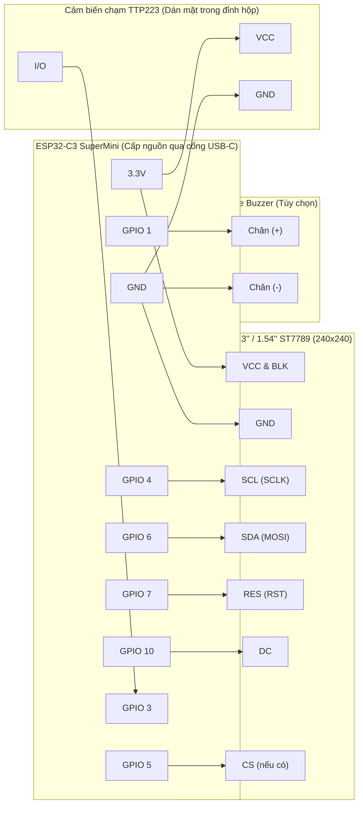

# Hướng Dẫn Tự Làm Mini Desk Pet Cảm Ứng (ESP32-C3 + ST7789)

Tài liệu này hướng dẫn chi tiết cách lắp ráp và nạp code cho cục **Mini Desk Pet cảm ứng** giống hệt thiết bị trong video gốc (cắm cáp USB-C trên đỉnh, màn hình màu hiển thị mặt robot xanh neon, chạm nhẹ hoặc xoa đỉnh đầu để đổi biểu cảm).

---

## 1. Danh sách linh kiện (Tổng chi phí ~120.000đ – 180.000đ)

Bạn có thể đặt mua dễ dàng trên Shopee / Lazada / các shop linh kiện điện tử:

| STT | Linh kiện | Thông số khuyên dùng | Giá tham khảo |
| :-: | :--- | :--- | :---: |
| 1 | **Vi điều khiển** | `ESP32-C3 SuperMini` (có sẵn cổng USB-C siêu gọn `22.5 × 18 mm`) | ~45.000đ |
| 2 | **Màn hình màu** | `IPS TFT LCD 1.3"` hoặc `1.54"` driver `ST7789` độ phân giải `240×240` (loại 7 chân hoặc 8 chân đều dùng được) | ~65.000đ |
| 3 | **Cảm biến chạm** | Module cảm biến chạm điện dung `TTP223` (kích thước nhỏ `15 × 11 mm`, nhận xuyên qua nhựa mỏng 2–3 mm) | ~5.000đ |
| 4 | **Còi hiệu ứng (Tùy chọn)** | Còi thụ động `Passive Buzzer 5V/3.3V` loại nhỏ `9 × 5.5 mm` | ~5.000đ |
| 5 | **Vỏ hộp & Dây nối** | Vỏ in 3D khối lập phương `38 × 38 × 38 mm` màu đen nhám (hoặc vỏ hộp nhựa đen mini / vỏ đồng hồ SmallTV), dây đồng bẹ / dây silicone AWG28, băng keo 2 mặt 3M | ~30.000đ |

---

## 2. Sơ đồ đấu nối dây

> **Lưu ý về cảm biến chạm `TTP223`:**
> - Để mặc định (không hàn cầu `A` và `B` trên lưng mạch `TTP223`): Khi chạm tay vào nắp hộp, chân `I/O` sẽ xuất mức `HIGH` (`3.3V`), nhấc tay ra về `LOW` (`0V`). Code trong `mini_desk_pet.ino` đã viết khớp sẵn với chế độ mặc định này.
> - Dùng băng keo 2 mặt mỏng dán mặt phẳng (mặt không có linh kiện) của `TTP223` áp sát vào mặt trong nắp trên của hộp nhựa (ngay cạnh lỗ cắm cáp USB-C, giống vị trí ngón tay chạm trong video).

---

## 3. Cách nạp code bằng Arduino IDE (Chỉ mất 3 phút)

Code được viết bằng thư viện **LovyanGFX** nên toàn bộ cấu hình chân nằm gọn trong file `.ino` — **không cần chỉnh sửa bất kỳ file thư viện hệ thống nào**.

1. **Cài đặt Board ESP32:**
   - Mở **Arduino IDE 2.x** -> vào `File > Preferences` -> thêm link sau vào *Additional Boards Manager URLs*:
     `https://espressif.github.io/arduino-esp32/package_esp32_index.json`
   - Vào **Boards Manager** (biểu tượng bo mạch bên trái) -> tìm `esp32` (của Espressif Systems) -> bấm **Install**.
2. **Cài đặt thư viện đồ họa (1 thư viện duy nhất):**
   - Vào **Library Manager** (biểu tượng chồng sách bên trái) -> gõ `LovyanGFX` -> bấm **Install** thư viện **LovyanGFX by lovyang03**.
3. **Mở và nạp code:**
   - Mở file `esp32-firmware/mini_desk_pet/mini_desk_pet.ino`.
   - Chọn `Tools > Board > esp32 > ESP32C3 Dev Module`.
   - Cắm cáp USB-C vào `ESP32-C3 SuperMini` (nếu mạch mới cắm lần đầu không nhận cổng COM, giữ nút `BOOT` trên mạch rồi bấm nhả nút `RST`, sau đó thả `BOOT`).
   - Bấm **Upload (→)**. Ngay khi nạp xong, màn hình sẽ hiện màn chào **`Hi`** kèm Pet nghiêng đầu ló lên, chạm nhẹ để đổi mặt, nhấn giữ > 0.5s sẽ bị choáng, và để yên mỗi 15 giây sẽ tự chạy hoạt ảnh `Luck is Yours` / ngân nga `♫`!

---

## 4. Mẹo lắp vào vỏ hộp để đẹp y hệt video

- **Tạo cổng cắm USB-C trên đỉnh hộp:** Xoay bo `ESP32-C3 SuperMini` hướng cổng USB-C lên mặt trên của khối vuông, khoét lỗ vừa khít đầu cắm cáp giống trong video.
- **Tăng độ tương phản màn hình Neon:** Dán thêm một tấm mica khói mỏng (hoặc phim dán kính đen mờ nhẹ 20%) che phủ mặt trước. Khi đó viền màn hình sẽ tiệp hoàn toàn vào vỏ hộp đen, chỉ còn đôi mắt và khung mặt xanh neon lơ lửng cực đẹp!
- **Xoay chiều hiển thị:** Nếu bạn lắp màn hình xoay ngang/ngược trong hộp, chỉ cần đổi dòng `SCREEN_ROTATION` trong file `.ino` thành `0`, `1`, `2` hoặc `3`.
