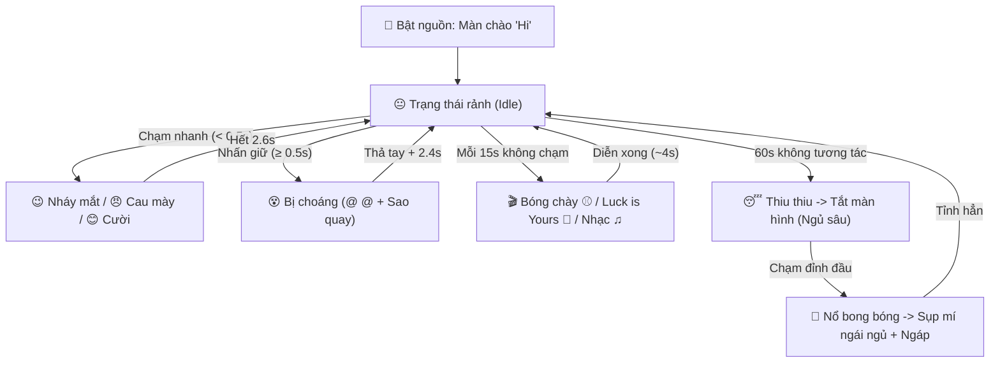

# 🐾 Mini Desk Pet — ESP32-C3 & ST7789 (240×240)

[](https://simulatorpet.vercel.app/)


Dự án tự làm **Mini Desk Pet cảm ứng để bàn** sử dụng vi điều khiển `ESP32-C3` kết hợp màn hình màu `IPS TFT ST7789 (240×240)` và cảm biến chạm `TTP223` đặt dưới nắp đỉnh hộp. Toàn bộ thuật toán đồ họa **60 FPS** được đồng bộ **1:1** giữa bản mô phỏng trên trình duyệt và firmware C++ nạp cho mạch thật.

👉 **Trải nghiệm bản Web Test trực tuyến tại đây:**  
🔗 **[Mini Desk Pet Simulator V3 — ESP32 ST7789 240×240](https://simulatorpet.vercel.app/)**

---

## ✨ Các chức năng & Hiệu ứng nổi bật

### 1. 👋 Hiệu ứng chào khi mới khởi động (`Boot Greeting`)
- Ngay khi cấp nguồn, màn hình xuất hiện chữ **`Hi`** màu trắng nổi bật ở góc trên bên trái.
- Chú Pet với dáng đầu Mochi bo tròn bầu bĩnh nghiêng đầu `-28°` ló lên từ góc dưới phải với đôi mắt cười cong `⌒ ⌒`, lắc lư chào rồi trượt mượt ra chính giữa màn hình.

### 2. 👆 Chạm nhẹ đỉnh đầu (`< 0.5s` — Đổi biểu cảm tương tác)
Mỗi lần chạm nhanh vào cảm biến trên đỉnh hộp (hoặc nhấn phím `Space` trên bản Web), Pet nhún nảy đàn hồi và luân chuyển qua các biểu cảm:
- **😐 Bình thường (`Idle`):** Khuôn mặt xanh neon tròn bầu, tự động chớp mắt cong `⌒ ⌒` và đảo mắt ngẫu nhiên tự nhiên.
- **😉 Nháy mắt (`Wink`):** Nháy một bên mắt phải thành dấu `<` tinh nghịch (`o <`).
- **😠 Cau mày / Dỗi (`Angry`):** Hai mắt xếch chéo dữ dằn (`\ /`).
- **😊 Cười tươi (`Happy`):** Hai mắt thu nhỏ phía trên cùng khuôn miệng cười rộng rạng rỡ.
- **🥶 Lạnh cóng & Đóng tảng băng (`Shiver -> Ice Cube -> Shatter`):** Tuyết rơi lất phất, Pet lạnh run cầm cập hai hàm răng va lập cập kèm giọt nước mũi đóng băng, sau đó bị **đóng cứng đơ bên trong tảng băng 3D trong suốt** treo nhũ băng nhọn — Pet gồng nứt tảng băng rồi **phá vỡ tung tóe** thành 12 mảnh băng văng tứ phía!
- **🫠 Tan chảy & Bốc hơi (`Overheat -> Melt -> Boil & Evaporate`):** Pet nóng bừng đỏ rực cả mặt (hai má ửng hồng `///`, đổ mồ hôi), chảy nhũn thành vũng nước đỏ dưới sàn, sau đó **sôi sùng sục** nổi bong bóng rồi **bốc hơi nghi ngút** thành mây khói trắng cho tới khi cạn sạch, rồi hồi sinh mát lạnh trở lại!

### 3. 😵 Nhấn giữ lâu bị choáng (`≥ 0.5s` — `Dizzy Mode`)
- Khi đặt ngón tay đè giữ lên đỉnh hộp: Đầu Pet bị ép dẹp xuống, nheo chặt hai mắt `> <` rung bần bật.
- Sau `0.5 giây`: Pet rơi vào trạng thái **bị choáng** — đầu nghiêng ngả lắc lư, hai tròng mắt xoay xoáy ốc `@ @` ngược chiều nhau kèm **3 ngôi sao vàng** bay quay vòng quanh đỉnh đầu.

### 4. 🎬 Tự động chạy hiệu ứng mỗi `15 giây` không chạm (`Idle Stories`)
Khi để yên trên bàn làm việc, cứ mỗi **15 giây** Pet sẽ tự động biểu diễn luân phiên **5 hoạt ảnh**:
1. **⚾ Đánh bóng chày (`Baseball Home Run`):** Pet đội mũ lưỡi trai vàng, cầm gậy bóng chày vàng chờ bóng bay tới rồi vung gậy tạo vệt sáng vàng quét ngang, đánh văng quả bóng bay vút lên trời lóe sao Home Run.
2. **🥠 Bánh quy may mắn (`3D Lucky Scroll`):** Chiếc bánh quy vàng rung lắc mạnh rồi tách ra thành **hai đầu cuộn vàng khối 3D**, trải dải lụa **trắng đổ bóng xanh uốn lượn chữ S** với bé Pet nháy mắt `• <` ló lên ở góc phải, các mảnh pháo giấy tam giác vàng `▲` và **10 câu chúc tự động uốn cong theo sóng** (*`Luck is Yours`*, *`Stay Happy :)`*, *`Good Vibes Only`*, *`Big Win Ahead!`*...), sau đó Pet nhảy tưng tưng ngay trên dải lụa.
3. **🥶 Tuyết rơi lạnh cóng → Đóng tảng băng & Phá băng (`Freeze & Shatter`).**
4. **🫠 Nóng đỏ mặt → Tan chảy & Sôi bốc hơi (`Melt & Boil`).**
5. **🎵 Ngân nga nốt nhạc (`Humming ♫`):** Pet nhắm mắt cười `⌒ ⌒` đung đưa qua lại cùng đám mây bọt xốp trắng-xanh và các nốt nhạc đôi `♫` bay bổng.

### 5. 😴 Để lâu tự ngủ & Đánh thức nổ bong bóng (`Auto-Sleep & Bubble-Pop Wakeup`)
- **Tự ngủ tiết kiệm điện (`60 giây` không tương tác):** Khung đầu xanh mờ dần, hai mắt nhắm cong xuống `︶ ︶` thổi phồng nhẹ quả bong bóng ngủ rồi **tắt đen hoàn toàn màn hình** (hỗ trợ tắt cả chân đèn nền `BLK`).
- **Chạm nhẹ để đánh thức (4 nhịp liên tiếp):**
  1. Quả bong bóng ngủ phồng căng tròn như thổi kẹo cao su sắp vỡ...
  2. **Bể cái "bụp"!** (kèm tiếng nổ *bụp* trên còi Buzzer) làm các giọt nước văng tung tóe, Pet giật mình nheo mắt `> <`.
  3. **Ngái ngủ:** Hai mắt mở lờ đờ **sụp mí trên**, đầu lắc lư chớp mắt nặng trĩu và **ngáp dài** (`o → O → o`).
  4. Lắc nhẹ đầu cho tỉnh hẳn rồi bật sáng khung đầu tròn trở lại trạng thái `Idle`.

### 6. 🔊 Âm thanh phản hồi (`Piezo Buzzer` / `Web Audio`)
- Phát tiếng kêu điện tử dễ thương riêng biệt cho từng hành động: chào `Hi`, nháy mắt, cau mày, tiếng gậy đập trúng bóng chày, tiếng *bụp* vỡ bong bóng ngủ và tiếng ngân choáng váng.

---

## 🔄 Sơ đồ luồng trạng thái



---

## 🛠️ Linh kiện & Sơ đồ chân nhanh

Chi tiết linh kiện, giá tham khảo (~150.000đ) và mẹo làm vỏ hộp xem đầy đủ tại **[HARDWARE_GUIDE.md](./HARDWARE_GUIDE.md)**.

| Linh kiện | Chân linh kiện | Chân `ESP32-C3 SuperMini` | Ghi chú |
| :--- | :---: | :---: | :--- |
| **Màn hình IPS `ST7789` 240×240** | `VCC` / `BLK` | `3.3V` | Có thể nối `BLK` vào GPIO để ngắt đèn nền khi ngủ |
| | `GND` | `GND` | Mass chung |
| | `SCL` (`SCLK`) | `GPIO 4` | Xung nhịp SPI (40 MHz) |
| | `SDA` (`MOSI`) | `GPIO 6` | Dữ liệu SPI |
| | `RES` (`RST`) | `GPIO 7` | Reset màn hình |
| | `DC` | `GPIO 10` | Data / Command |
| | `CS` | `GPIO 5` | Bỏ trống nếu dùng màn 7 chân không có `CS` |
| **Cảm biến chạm `TTP223`** | `VCC` / `GND` | `3.3V` / `GND` | Dán áp mặt trong đỉnh hộp nhựa |
| | `I/O` | `GPIO 3` | Xuất mức `HIGH` khi chạm |
| **Còi `Passive Buzzer`** *(Tùy chọn)* | `(+)` / `(-)` | `GPIO 1` / `GND` | Phát hiệu ứng âm thanh |

---

## 📂 Cấu trúc dự án

```text
mini_desk_pet/
├── index.html                              # Bản Web Simulator độc lập (deploy trên Vercel)
├── esp32-firmware/
│   └── mini_desk_pet/
│       └── mini_desk_pet.ino               # Code C++ nạp cho ESP32-C3 (dùng LovyanGFX)
├── HARDWARE_GUIDE.md                       # Hướng dẫn linh kiện, sơ đồ mạch & lắp vỏ hộp
└── README.md                               # Tài liệu giới thiệu & tổng hợp tính năng
```

---

## 🚀 Hướng dẫn chạy & Nạp code nhanh

1. **Test trực tiếp trên trình duyệt (không cần mạch):**
   - Truy cập **[Mini Desk Pet Simulator V3 — ESP32 ST7789 240×240](https://simulatorpet.vercel.app/)** (hoặc mở file `index.html` trên máy).
   - Phím tắt trên máy tính: `Space` (chạm nhẹ / đánh thức), `B` (đánh bóng chày), `S` (bật/tắt chế độ ngủ).
2. **Nạp lên mạch `ESP32-C3` thực tế:**
   - Cài **Arduino IDE 2.x** và gói bo mạch `esp32` (của Espressif Systems).
   - Mở **Library Manager**, tìm và cài duy nhất thư viện **`LovyanGFX`** (của *lovyang03*) — mọi cấu hình chân đã nằm gọn trong file `.ino`, không cần sửa file thư viện ngoài.
   - Mở `esp32-firmware/mini_desk_pet/mini_desk_pet.ino`, chọn board **`ESP32C3 Dev Module`** và nhấn **Upload**.
